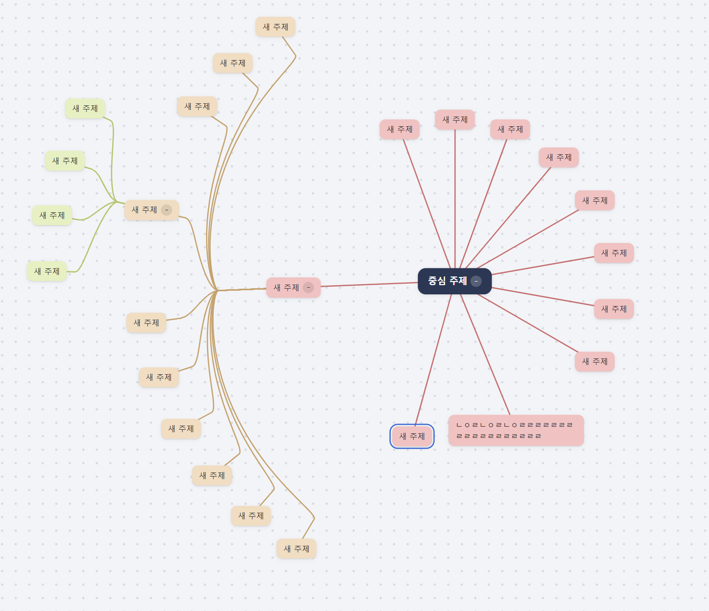
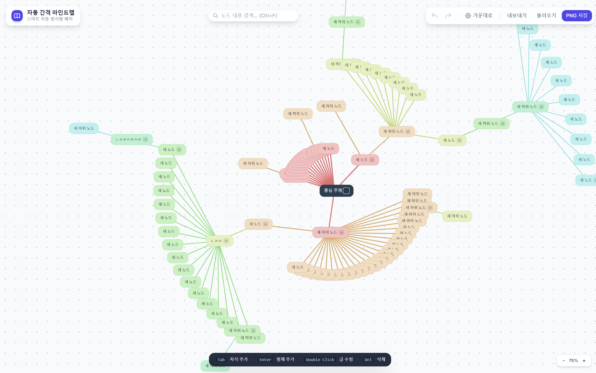
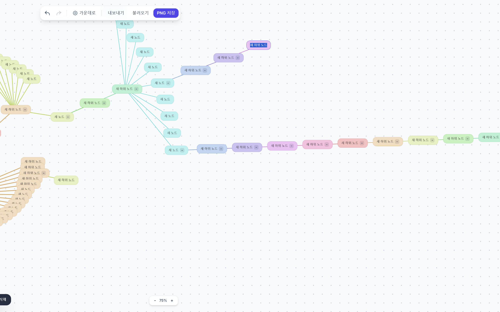
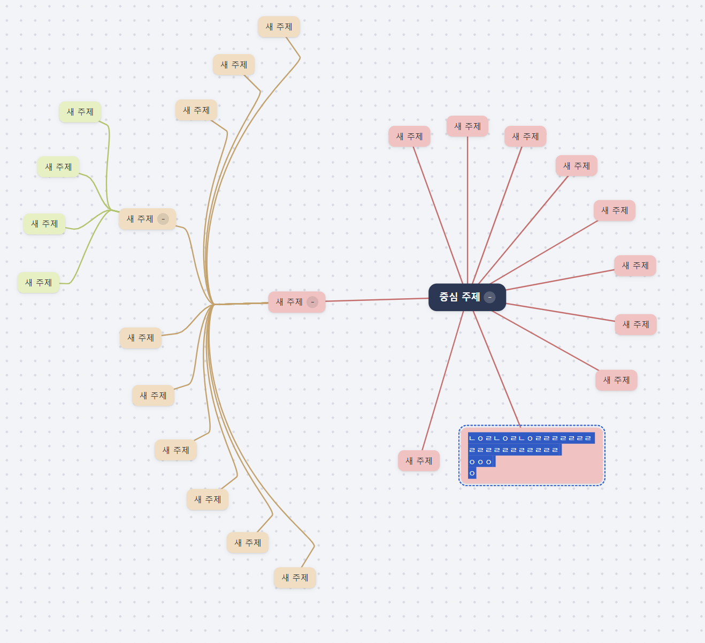
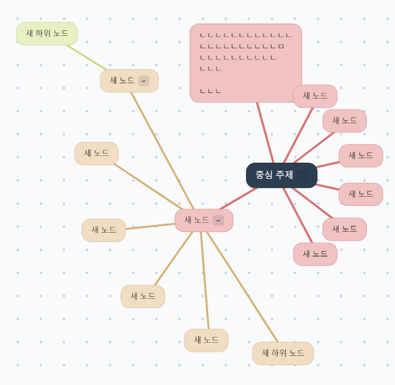
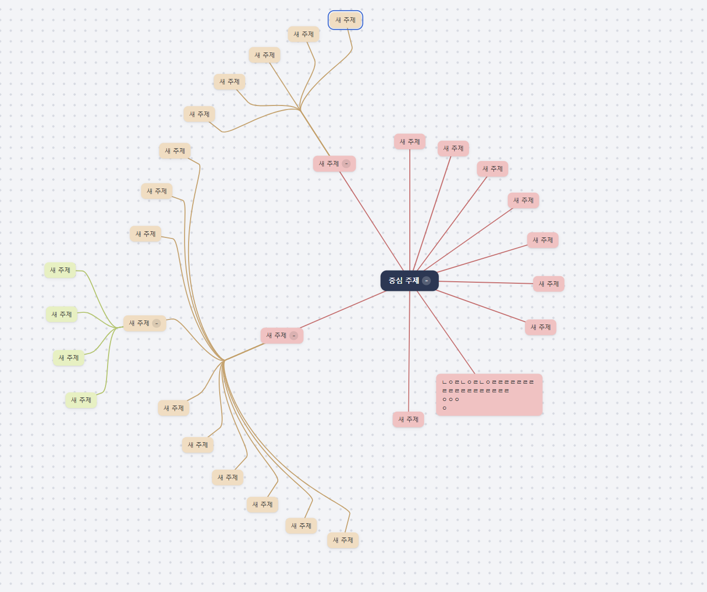
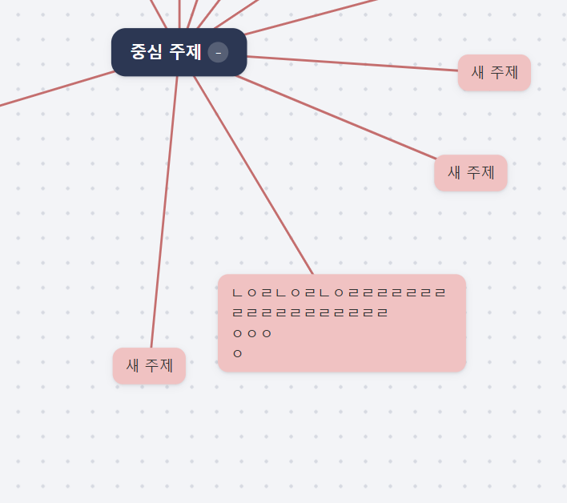
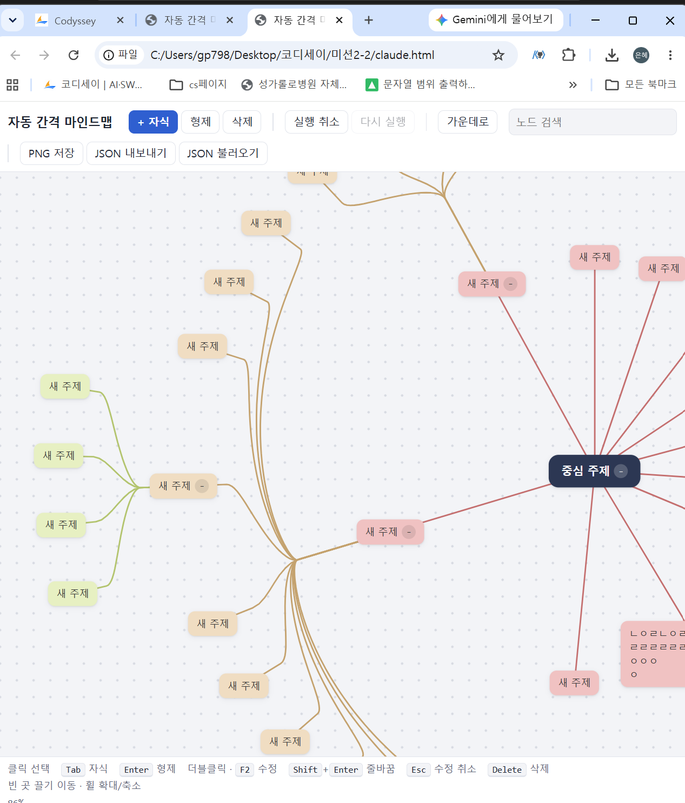

# 제작·검증 기록: 자동 간격 마인드맵

## 두 AI 비교
- AI A (서비스·모델 이름): Claude (Opus5.5)
- AI B (서비스·모델 이름): Gemini (Flash)
- 동일한 기획서와 함께 전달한 요청:  "첨부한 기획서 내용을 기반으로 html 페이지를 제작해줘"

| 테스트 내용 | AI A(Claude) | AI B(Gemini) |
| --- | --- | --- |
| 생성시간 | 10분 | 4분 |
|랜덤하게 자식,형제 노드생성| 동심원을 그리며 생성됨. 간격 잘 유지 됨| 부채꼴로 생성. 초기엔 간결해서 좋지만, 형제노드가 많으면 겹침. 중심을 벗어나 tab을 하면 화면 전환이 번갈아 됨|
| Shift+enter를 통해 노드 크게 부풀리기 |  알아서 간극 조절, 안겹침 |  노드가 겹침|
|del로 노드 연속 삭제|삭제 후 형제로 포커스 이동|삭제 후 부모로 포커스 이동|

- 선택한 결과물과 근거: 최종적으로 Claude를 선택하였다. 기획의 궁극적인 목표는 사용자가 신경쓰지 않아도 겹치지 않는 노드였기 때문에 다양한 상황에서도 겹치지 않도록 만들어진 Claude의 코드를 선택했다.

## 테스트 기록
| 번호 | 테스트 내용 | 예상 결과 | 실제 결과 |
| --- | --- | --- | --- |
| 1 | 30개 노드를 생성 | 노드간 겹침없도록 계산되어 생성 |  매 노드 생성마다 겹치지 않게끔 간격을 계산하며 생성되어짐 |
| 2 | 글자 수정 중 Shift+Enter를 누르면 줄바꿈이 되는지 테스트 |형제생성으로 넘어가지 않고 줄바꿈 됨, 간격이 자동 계산되어 노드간 겹치지 않음 |   줄바꿈 잘 됨, 매 줄바꿈마다 노드 크기 및 노드간 간격 계산되어 겹치지 않음|
| 3 | 좁은 화면으로 변경하여 테스트 | pc 브라우저용으로 명칭했기 떄문에 잘릴 것으로 예상 |  예상대로 마인드맵은 그대로 잘리지만 위아래 Tool bar는 반응형 웹처럼 재배치됨 |

