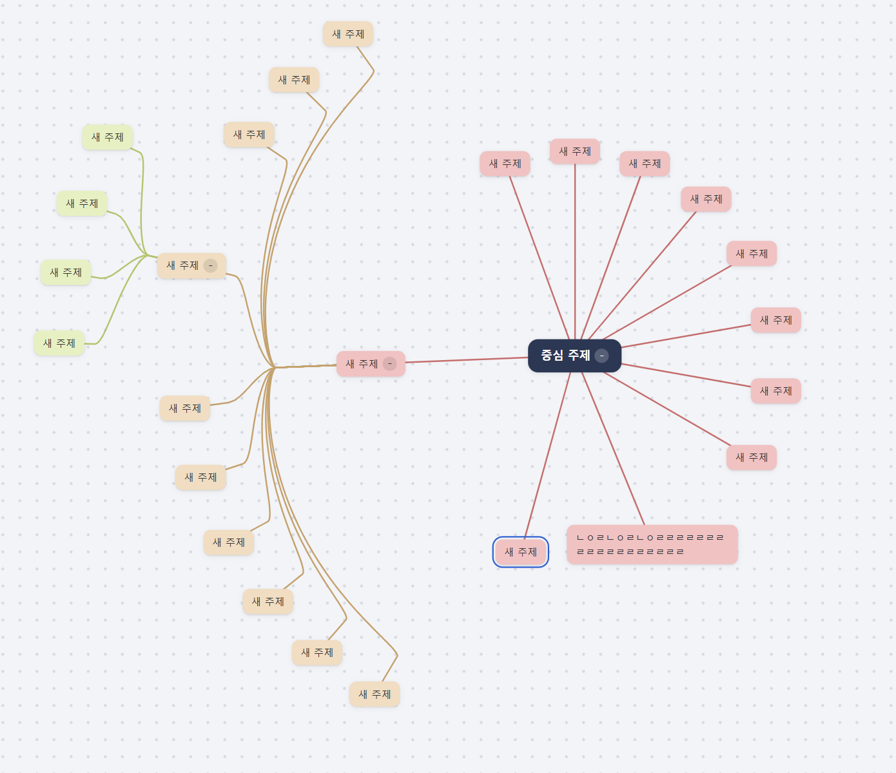
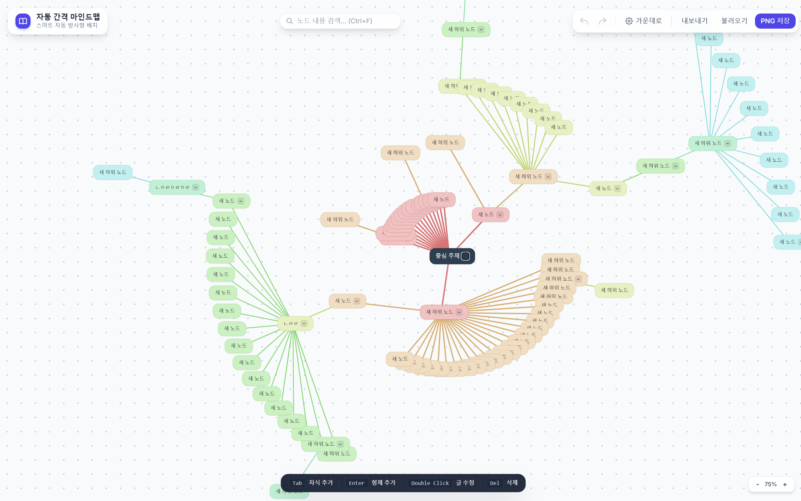
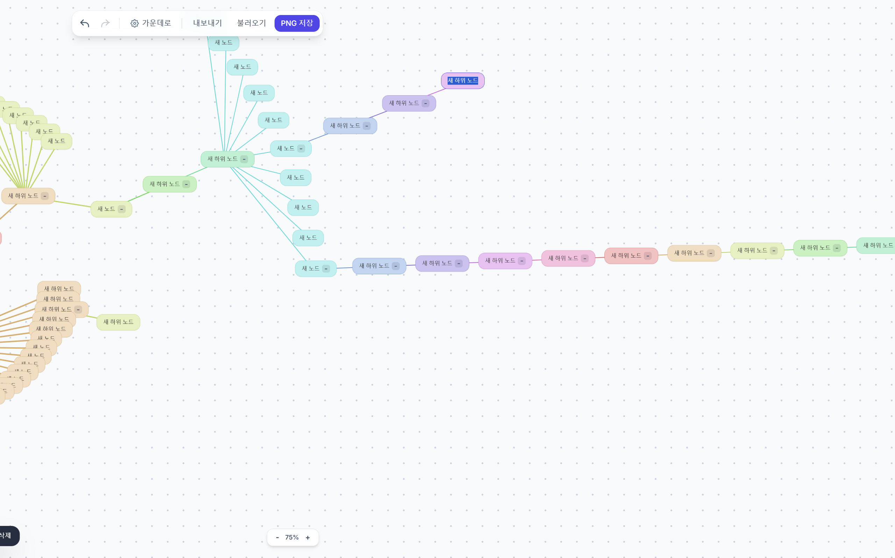
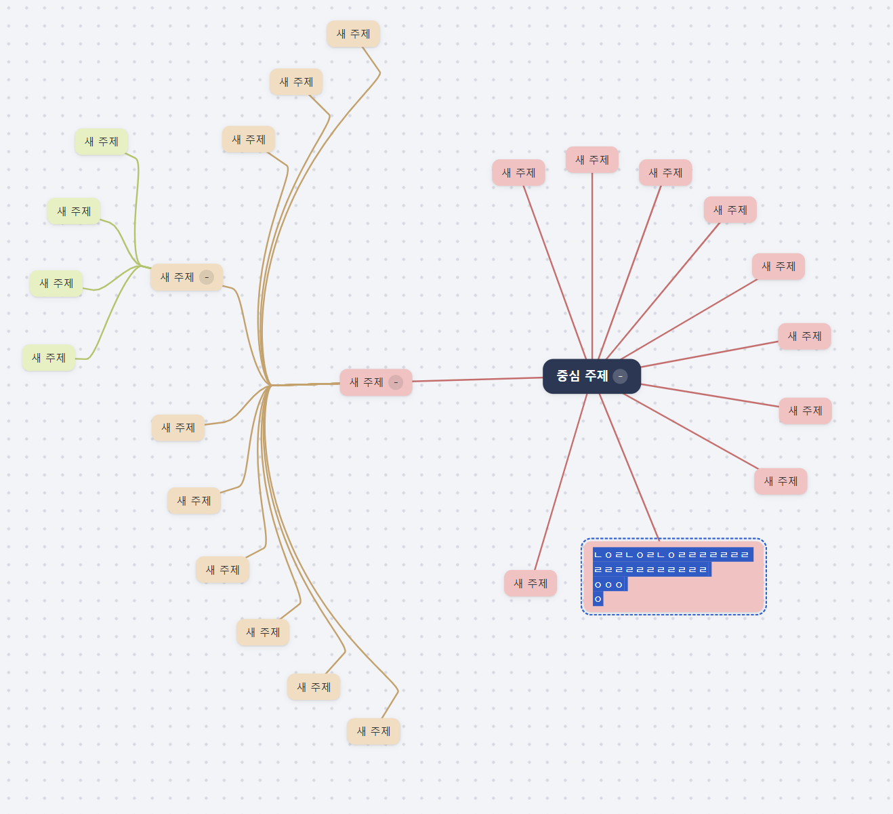
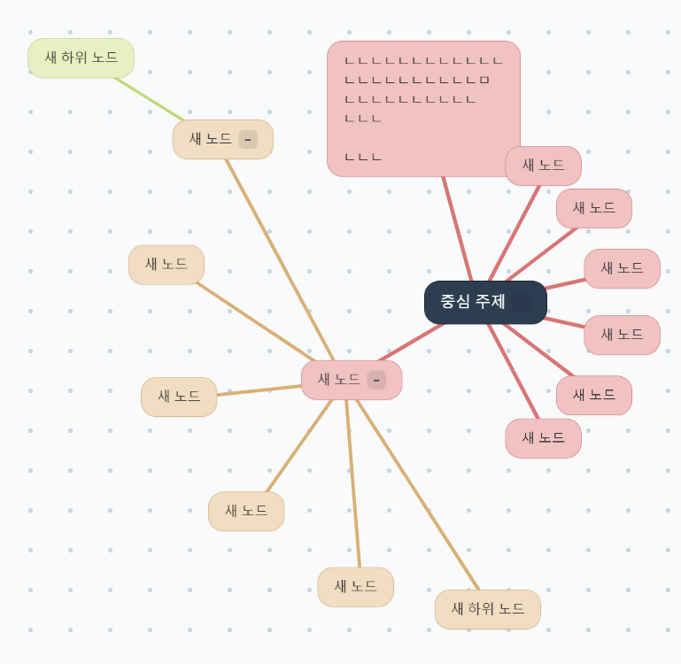
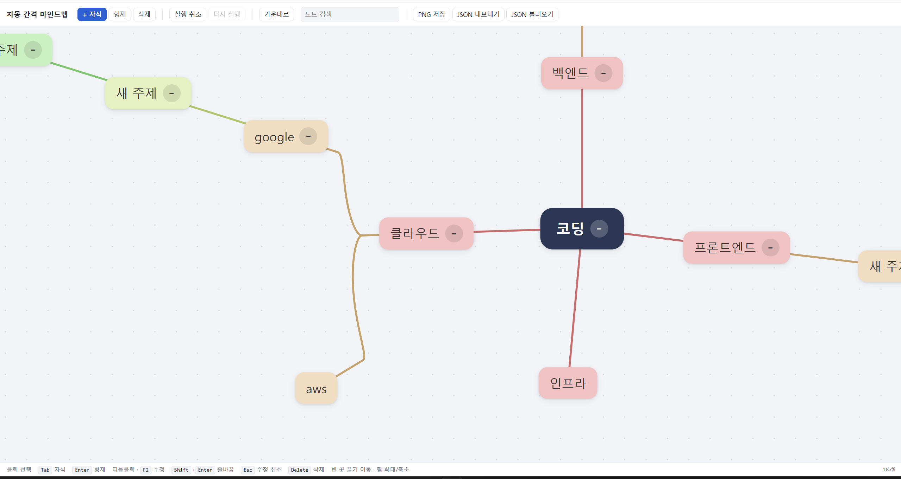

# 제작·검증 기록: 자동 간격 마인드맵

## 두 AI 비교
- AI A (서비스·모델 이름): Claude (Opus5.5)
- AI B (서비스·모델 이름): Gemini (Flash)
- 동일한 기획서와 함께 전달한 요청:  "첨부한 기획서 내용을 기반으로 html 페이지를 제작해줘"

| 테스트 내용 | AI A(Claude) | AI B(Gemini) |
| --- | --- | --- |
| 생성시간 | 10분 | 4분 |
|랜덤하게 자식,형제 노드생성| 동심원을 그리며 생성됨. 간격 잘 유지 됨| 부채꼴로 생성. 초기엔 간결해서 좋지만, 형제노드가 많으면 겹침. 중심을 벗어나 tab을 하면 화면 전환이 번갈아 됨|
| Shift+enter를 통해 노드 크게 부풀리기 |  알아서 간극 조절, 안겹침 |  노드가 겹침|
|del로 노드 연속 삭제|삭제 후 형제로 포커스 이동|삭제 후 부모로 포커스 이동|

- 선택한 결과물과 근거: 최종적으로 Claude를 선택하였다. 기획의 궁극적인 목표는 사용자가 신경쓰지 않아도 겹치지 않는 노드였기 때문에 다양한 상황에서도 겹치지 않도록 만들어진 Claude의 코드를 선택했다.

## 사용자 테스트
- 테스트 참여자와 요청한 작업: 마음대로 마인드맵을 작성하되 노드는 30개 까지만 작성해봐
- 사용자의 행동과 질문:
    - 화면을 짧게 보더니 아래의 설명을 읽지 못했는지, "어떻게 하는 거야?" 하고 물었습니다.
    - 한 노드를 채우던 중, 다른 노드에 오타를 발견하고, 화면 축소로 작아진 아이콘을 어렵게 클릭하면서, "아 이거 클릭이 좀 어렵다."고 말했습니다.
- 받은 피드백: "마우스를 쓰지 않고도 이동할 수 있으면 좋겠어. 흐름이 깨지는 것 같아."
- 반영 내용과 결과: 부모는 위 방향키, 자식은 아래 방향키, 형제는 좌,우 방향키로 이동하게 구현하였습니다.

## 테스트 기록 (사용자 테스트 반영)
| 번호 | 테스트 내용 | 예상 결과 | 실제 결과 |
| --- | --- | --- | --- |
| 1 | 화면을 적당히 확대해 특정 노드만 보이게 한 상태에서 enter를 통해 자식 노드를 생성해 기존 포커싱이 어떻게 이동하는지 관찰| 새로 생성된 노드로 포커싱이 이동한다. |자식노드를 생성할때 마다 화면 포커싱이 튐  왼쪽 맨끝에 있어야 하는 화면이 중심으로 돌아옴 |
| 2 | 테스터에게 프로그램을 보여주고 바로 사용해보라 지시 후 관찰 | 아래 툴바의 설명을 보고 shift+enter, tab을 자유자제로 사용 | 곧바로 사용하지 못함 |
| 3 | 테스터에게 프로그램을 지속적으로 사용을 지시하고 행동관찰 | 주어진 키를 활용해 프로그램 사용 | 구현되지 않은 노드 포커싱 이동을 하려고 방향키를 자주 누름|

## 수정 기록
### 수정 기록 1
- 발견한 문제: 화면을 적당히 확대해 특정 노드가 보이게 한 상태에서 enter를 통해 자식 노드를 생성해 기존 포커싱이 현재 노드-> 새로생성된 노드로 이동해야 할 때, 형제노드를 생성하게 되면 새로 생긴 노드가 아닌 루트 노드에 포커싱이 맞춰짐.
- AI에게 전달한 요청:"자식노드를 화면 포커싱이 바뀔 때까지 생성한 후, 이상태에서 형제노드를 생성하면 이따금씩 루트 노드로 포커스가 돌아가. 이에 대해서는 기획서에서 따로 정의하진 않았지만, 최근 포커싱된 노드에 화면 포커싱이 유지되게 html을 수정해줘.다른기능은 건들지마"
- 수정 후 테스트 결과: 같은 시나리오로 테스트를 돌려도 계속 새 노드에 포커싱이 맞음
- 수정 이유: 사용자는 방금 만든 노드에 바로 내용을 입력하려고 한다. 그런데 화면이 루트 노드로 튀면 새 노드를 다시 찾아야 하고, 그 과정에서 작성 흐름이 끊기게 된다. 기획서에 정의되지 않은 동작이었지만, "사용자가 신경 쓰지 않아도 되는 마인드맵"이라는 기획 목표에 어긋난다고 판단했다. 그래서 화면 포커스가 항상 최근에 선택되거나 생성된 노드를 따라가도록 수정했다. 다른 기능에 영향이 가지 않도록 수정 범위도 포커싱 로직으로 한정했다.

### 수정 기록2
- 발견한 문제: 아래 툴바에 적어진 사용법을 인지하지 못해 곧바로 사용이 어려움
- AI에게 전달한 요청:"웹페이지에 처음 입장하거나, 새로고침하면 불투명한 도움말 창이 뜨고 형제, 자식 노드 만드는 법을 약간의 움짤로 보여주고 사용자는 언제든 창을 닫을 수 있게 구현해줘."
- 수정 후 테스트 결과: 처음 입장하면 도움말 모달이 직관적으로 뜸
- 수정 이유: 테스터는 하단 툴바의 설명을 인지하지 못했고, 처음에 "어떻게 하는 거야?"라고 물었다(테스트 2). 이 서비스는 키보드 단축키(Enter, Tab, Shift+Enter)가 핵심 조작 방식이라, 첫 진입 때 사용법을 알지 못하면 아예 사용을 시작할 수 없다. 작게 적힌 텍스트 설명보다 시선을 끄는 모달과 움짤 예시가 사용법을 더 빠르게 전달한다고 판단했고 또 이미 익숙한 사용자를 방해하지 않도록 언제든 닫을 수 있게 했다.

### 수정 기록3
- 발견한 문제: 노드 사이를 이동하려면 매번 마우스로 노드를 클릭해야 함. 키보드로 노드를 만들고 입력하다가 다른 노드로 가려면 손을 마우스로 옮겨야 해서 작성 흐름이 끊김. 
- AI에게 전달한 요청: "마우스 없이도 방향키로 노드간 이동할 수 있으면 좋겠어."
- 수정 후 테스트 결과: ↑로 부모, ↓로 자식, ←/→로 형제 노드로 이동함. ↑로 올라갔다가 ↓를 누르면 방금 있던 자식 노드로 돌아오고, 형제 이동은 양 끝에서 반대쪽 끝으로 순환함. 이동한 노드가 화면 밖에 있으면 화면이 따라가며, 글자 수정 중이거나 검색창 입력 중에는 방향키가 원래대로 동작함.
- 수정 이유: 이 서비스는 Enter·Tab 같은 키보드 단축키로 노드를 만드는 것이 핵심 조작 방식이다. 그런데 노드 이동만 마우스에 의존하면 키보드와 마우스를 오가야 해서 생각을 이어서 적는 흐름이 끊긴다. 트리 구조와 방향을 직관적으로 맞춰 위는 부모, 아래는 자식, 좌우는 형제로 정했다. 위로 올라갔다가 다시 내려올 때 원래 위치로 돌아오게 해서 탐색 중에 길을 잃지 않도록 했다. 방사형 배치라 형제가 원을 따라 놓이므로 좌우 이동도 순환하도록 했다. 하단 단축키 안내에도 방향키 사용법을 추가했다.